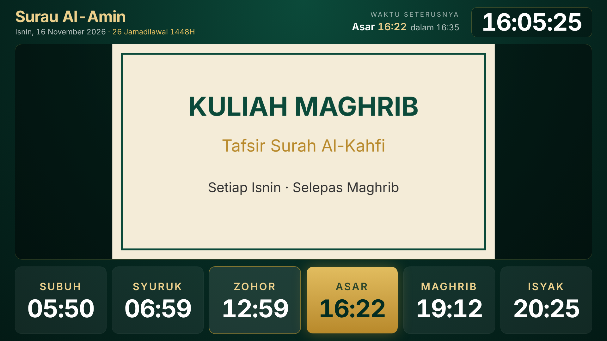
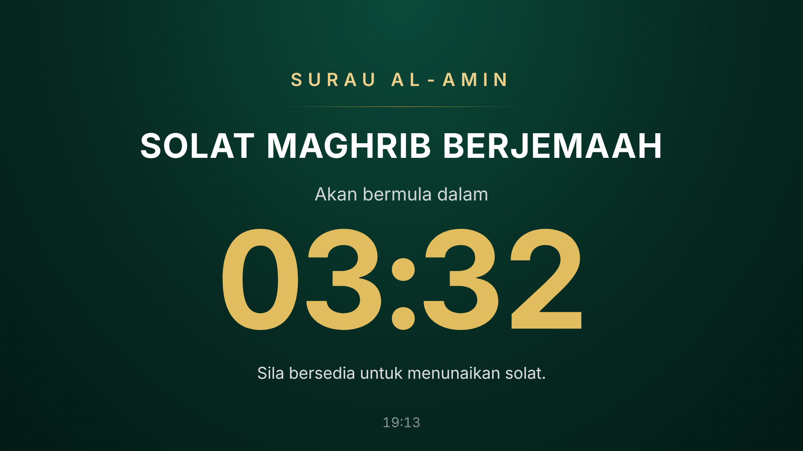
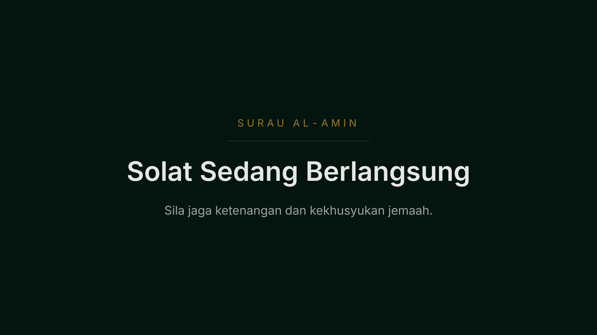

# WaktuSolat

Multi-mosque prayer-time and digital-signage **Progressive Web App** for mosques and suraus in Malaysia.

Each approved mosque gets a public TV page (e.g. `https://waktusolat.vercel.app/surau-al-amin`) that shows the official JAKIM prayer times, a clock with Gregorian/Hijri date and a slideshow of posters. When a prayer time arrives the screen switches automatically to a **countdown**, then to a calm, static **Solat Mode**, then back to the slideshow.

| Normal | Countdown | Solat Mode |
|---|---|---|
|  |  |  |

## Features

- **Three roles**: Master Super Admin (`/master`), one Mosque Super Admin per mosque (`/admin`), and anonymous public viewers (`/[slug]`).
- **Registration & approval**: email-verified applications with a private authorisation document; the Master approves, rejects or requests more information. One active admin per mosque is enforced by a database constraint plus transactional SQL functions; admin replacement is explicit and audited.
- **Official prayer times** from JAKIM e-Solat per zone, cached in Postgres, strictly validated, never substituted. Missing data shows a warning and disables automatic Prayer Mode.
- **Prayer Mode state engine**: pure, deterministic `NORMAL → COUNTDOWN → SOLAT → NORMAL` computed from corrected time, schedule, published settings, Friday rules and manual overrides. Browser refresh, sleep/wake and reconnects resume at the correct remaining time.
- **Per-prayer settings** (countdown, Solat duration, messages, enable/disable), Jumaat settings, draft → publish workflow, and **manual overrides** (start countdown/Solat now, end, return to automatic) with expiry and audit.
- **Media**: images (JPEG/PNG/WebP ≤ 2 MB) and optional MP4 H.264 video; magic-byte validation, codec check, TV-sized optimisation that keeps poster text sharp; **100 MB per-mosque quota** enforced with row-locked reservations (concurrency-safe).
- **Slideshow engine**: per-item duration, effect (fade, slide left/right, zoom in/out, wipe, none), transition speed and fit; two-layer crossfade (no blank frames), preloading, failed-media skipping, safe-boundary playlist switching, autoplay-blocked video skipping.
- **Realtime + polling**: Supabase Realtime broadcast tells TVs to refetch; 60 s polling fallback. Publications never interrupt an active Prayer Mode.
- **Offline**: last payload cached in `localStorage` (works without a service worker); optional service worker caches the app shell and published media and prunes stale media.
- **Monitoring**: display heartbeats, storage dashboards, immutable audit logs, in-app notifications.
- UI in **Bahasa Melayu**; code and technical docs in English.

## Stack

Next.js 16 (App Router, TypeScript) · Tailwind CSS 4 · Supabase (Auth, Postgres + RLS, Storage, Realtime) · Zod · Vercel · Vitest · Playwright.

## Quick start

```bash
npm install
cp .env.example .env.local   # fill in Supabase keys
npm run dev
```

See **[docs/SETUP.md](docs/SETUP.md)** for the full local setup, including applying the migrations and creating the Master Super Admin.

## Tests

```bash
npm run test        # unit: prayer engine, e-Solat parser, validation, slideshow, file sniffing
npm run test:db     # database: RLS, tenancy, approval workflow, quota concurrency (local PostgreSQL 16)
npm run build && npm run test:e2e   # Playwright: TV display end-to-end, route protection
```

## Documentation

| Document | Contents |
|---|---|
| [docs/SETUP.md](docs/SETUP.md) | Local development and Supabase project setup |
| [docs/DATABASE.md](docs/DATABASE.md) | Schema, ownership & permission model, functions, RLS |
| [docs/DEPLOYMENT.md](docs/DEPLOYMENT.md) | Supabase + Vercel production deployment checklist |
| [docs/ADMIN_GUIDE.md](docs/ADMIN_GUIDE.md) | Guide for Master and mosque administrators (Bahasa Melayu) |
| [docs/ANDROID_TV_SETUP.md](docs/ANDROID_TV_SETUP.md) | Running the display on Android TV |
| [docs/RASPBERRY_PI_SETUP.md](docs/RASPBERRY_PI_SETUP.md) | Raspberry Pi kiosk setup |
| [docs/ARCHITECTURE.md](docs/ARCHITECTURE.md) | Design decisions, assumptions and known limitations |

## Project layout

```
src/app/            routes: /, /register, /login, /[slug], /admin/*, /master/*, /api/*
src/components/     UI kit, dashboard shell, TV display (DisplayApp, Slideshow)
src/lib/prayer/     state engine, e-Solat client/parser, schedule sync
src/lib/            auth, validation, media processing, realtime, rate limiting
supabase/migrations SQL schema, RLS, functions, zones, buckets
tests/unit|db|e2e   Vitest + PostgreSQL + Playwright suites
scripts/            master bootstrap, local test database, icon generator
```
